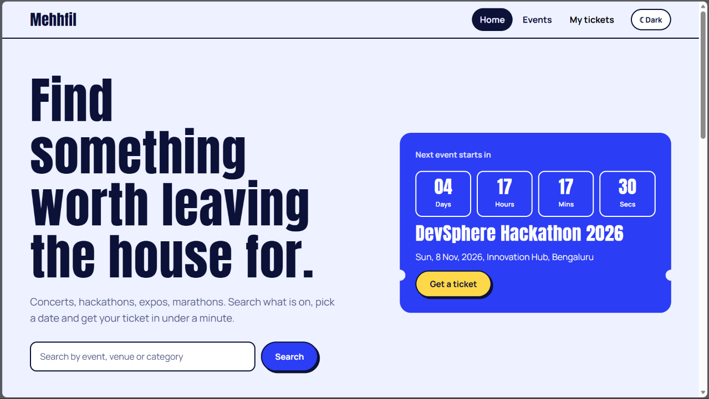

# Eventora: Responsive Event Management Website

Eventora lets people discover upcoming events, read the details and register with a validated form.
Built for the **K Explore – Web Designing** task with plain **HTML5, CSS3 and JavaScript** (no frameworks, no build step).

**Live site:** https://YOUR-USERNAME.github.io/eventora/  
**Repository:** https://github.com/YOUR-USERNAME/eventora



## Features

| Requirement | How it is implemented |
|---|---|
| Hero section | Headline, search box and a live "next event" ticket with countdown (`index.html`) |
| Upcoming and featured events | Featured grid on the home page, full list on `events.html` |
| Event cards | Image, date badge, category, name, venue, time, short description and price |
| Browse, search, filter | Live search, category chips, sort by date or price, shareable URLs (`events.html?cat=Tech&q=hack`) |
| Event details | `event.html?id=…` shows facts, countdown and a full description |
| Registration form | Name, email, phone and selected event, all validated with JavaScript |
| Confirmation | Success panel with a ticket ID after a valid submit |
| Responsive | Mobile-first CSS Grid and Flexbox, tested at 360px, 768px and 1280px+ |
| Bonus | Light/dark mode, countdown timers, animations, Local Storage registrations ("My tickets" with cancel) |

### Validation rules
- **Name:** letters, spaces and `. ' -`, 3 to 50 characters
- **Email:** standard `name@domain.tld` pattern
- **Phone:** 10-digit Indian mobile number starting 6 to 9, optional `+91`
- **Event:** must be selected; duplicate email for the same event and sold-out events are rejected

## Project structure
```
eventora/
├── index.html      home: hero, featured events, categories
├── events.html     search, filter and sort
├── event.html      details and registration
├── css/style.css   design tokens, layout, components, dark theme
├── js/data.js      event data (dates are relative to today)
└── js/app.js       shared shell, rendering, validation, Local Storage
```

## Run locally
Open `index.html` in a browser, or use the VS Code **Live Server** extension. An internet connection is needed for Google Fonts and the sample photos.

## Deployment (GitHub Pages)
Repository **Settings → Pages → Deploy from a branch → `main` / `(root)`**.

## Design notes
A ticket motif runs through the interface: notched cards, dashed tear lines, date stubs and a countdown. Flat colour and hard shadows keep it distinct from typical gradient templates. Colours live in CSS variables, so the dark theme is a single override block.

## Possible improvements
Backend for real registrations, email confirmations, admin dashboard, calendar export.
